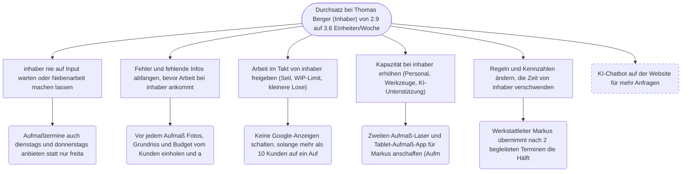

> ENTWURF — vor Weitergabe an den Kunden durch einen Menschen zu prüfen (Brief §16).

## Zielbaum

- Durchsatz bei Thomas Berger (Inhaber) von 2.9 auf 3.6 Einheiten/Woche steigern — _Fertigstellungen/Woche bei Thomas Berger (Inhaber)_
  - inhaber nie auf Input warten oder Nebenarbeit machen lassen
    - Aufmaßtermine auch dienstags und donnerstags anbieten statt nur freitags und samstags `non_ai · exploit · 1 Tage`
  - Fehler und fehlende Infos abfangen, bevor Arbeit bei inhaber ankommt
    - Vor jedem Aufmaß Fotos, Grundriss und Budget vom Kunden einholen und als Vorlage vorbereiten (ca. 9 Vorlagen pro Woche) `ai_doable · exploit · 4 Tage`
  - Arbeit im Takt von inhaber freigeben (Seil, WIP-Limit, kleinere Lose)
    - Keine Google-Anzeigen schalten, solange mehr als 10 Kunden auf ein Aufmaß warten `non_ai · subordinate · 1 Tage`
  - Kapazität bei inhaber erhöhen (Personal, Werkzeuge, KI-Unterstützung)
    - Zweiten Aufmaß-Laser und Tablet-Aufmaß-App für Markus anschaffen (Aufmaß 2 h -> 1,5 h) `human · elevate · 5 Tage`
  - Regeln und Kennzahlen ändern, die Zeit von inhaber verschwenden
    - Werkstattleiter Markus übernimmt nach 2 begleiteten Terminen die Hälfte der rund 9 Aufmaße pro Woche `non_ai · exploit · 5 Tage`
  - KI-Chatbot auf der Website für mehr Anfragen `ai_doable · exploit · 5 Tage` ~~(verworfen)~~

## Priorisierte Maßnahmen

1. [non_ai] Aufmaßtermine auch dienstags und donnerstags anbieten statt nur freitags und samstags (exploit, 1 Tage)
2. [non_ai] Werkstattleiter Markus übernimmt nach 2 begleiteten Terminen die Hälfte der rund 9 Aufmaße pro Woche (exploit, 5 Tage)
3. [ai_doable] Vor jedem Aufmaß Fotos, Grundriss und Budget vom Kunden einholen und als Vorlage vorbereiten (ca. 9 Vorlagen pro Woche) (exploit, 4 Tage)
4. [non_ai] Keine Google-Anzeigen schalten, solange mehr als 10 Kunden auf ein Aufmaß warten (subordinate, 1 Tage)
5. [human] Zweiten Aufmaß-Laser und Tablet-Aufmaß-App für Markus anschaffen (Aufmaß 2 h -> 1,5 h) (elevate, 5 Tage)

